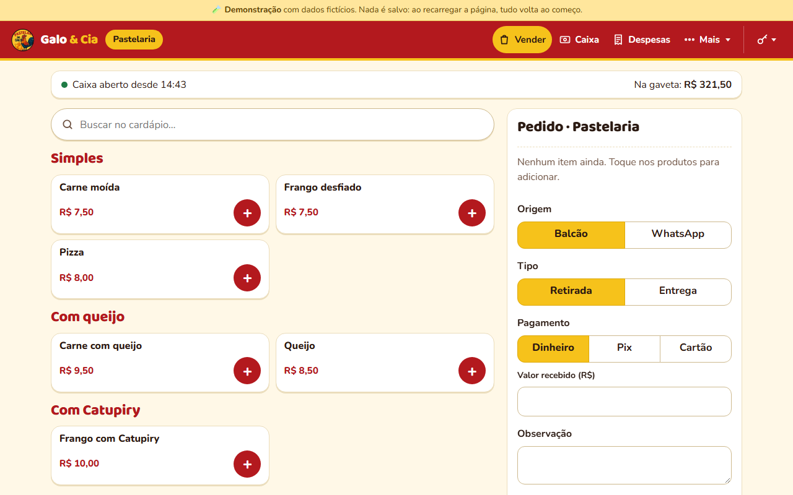
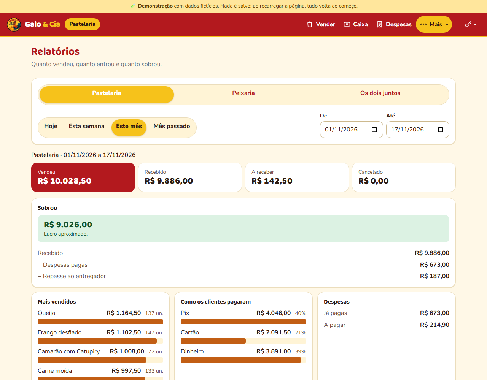
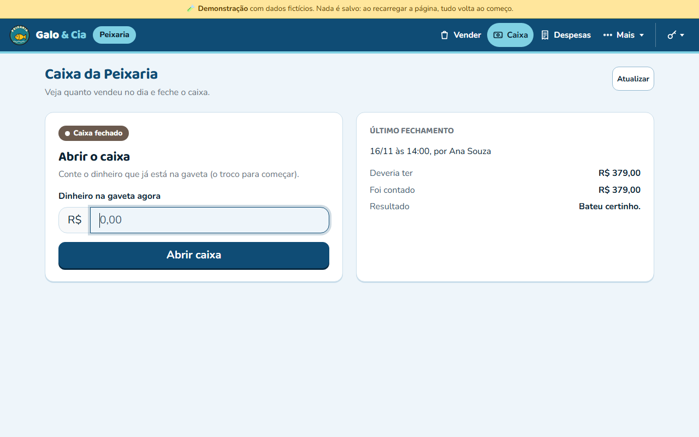
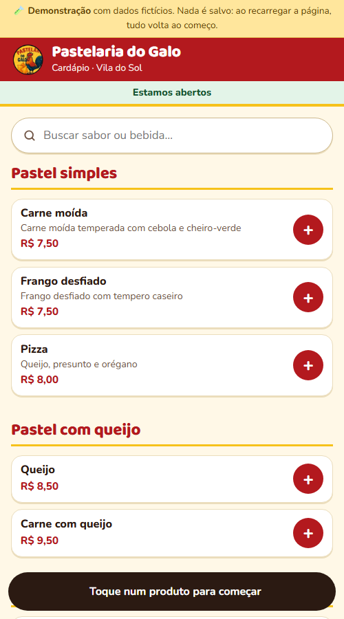
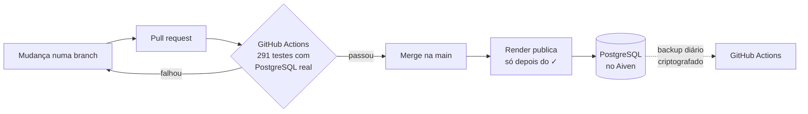

# Galo & Cia

[](https://github.com/cybellesantos-byte/galo-e-cia/actions/workflows/testes.yml)


[](LICENSE)

Sistema de gestão da **Pastelaria do Galo** e de uma **peixaria** de família:
caixa, vendas, despesas, repasses ao entregador, relatórios e um **cardápio
público** para o cliente pedir pelo WhatsApp. Ele substituiu o caderno e está
em uso de verdade, no dia a dia do negócio.

> 🎮 **Quer ver funcionando?** O sistema real exige login e tem dados da família.
> Por isso existe uma **[demonstração clicável com dados fictícios](https://cybellesantos-byte.github.io/galo-e-cia-demo/)**:
> dá para vender, abrir e fechar o caixa, ver os relatórios e fazer um pedido no cardápio.

> Este repositório é uma réplica pública do projeto. Bairros, endereço e
> contatos foram trocados por dados fictícios.

## Telas

| Venda no balcão | Relatórios |
|---|---|
|  |  |

| Caixa da peixaria | Cardápio do cliente (celular) |
|---|---|
|  |  |

## O que o sistema faz

- **Caixa do dia**: abertura com troco, sangria, fechamento com a diferença
  entre o esperado e o contado.
- **Vendas**: pastelaria por unidade e peixaria por quilo, com troco, Pix,
  cartão, retirada ou entrega e taxa por bairro.
- **Despesas e repasses**: compras de cada negócio e o acerto com o entregador.
- **Relatórios**: quanto vendeu, quanto entrou, quanto sobrou, os mais vendidos
  (com a lista completa), formas de pagamento e comparação entre os negócios.
- **Cardápio público**: o cliente escolhe os itens e o pedido chega pronto no
  WhatsApp. Produtos podem ser escondidos do cardápio sem sair do balcão.
- **Equipe e auditoria**: perfis de administradora e equipe, com registro de
  quem fez cada ação.

## Tecnologias

| Parte | Tecnologia |
|---|---|
| Linguagem | Java 25 (LTS) |
| Framework | Spring Boot 4.1 (Web MVC, Data JPA, Security, Validation) |
| Interface | HTML, CSS, Bootstrap e JavaScript puro (módulos ES), sem build |
| Banco | PostgreSQL 18, migrações com Flyway |
| Testes | JUnit 5, Mockito e Testcontainers (PostgreSQL real, sem H2) |
| Entrega | Docker, GitHub Actions, Render (aplicação) e Aiven (banco) |

## Como o código chega ao ar



## Rodar no seu computador

**Pré-requisitos:** JDK 25 (com `JAVA_HOME` apontando para ele) e Docker ligado.

1. Crie o `.env` a partir do modelo e troque as senhas:
   ```bash
   cp .env.example .env
   ```
2. Suba o banco:
   ```bash
   docker compose up -d
   ```
3. Rode o sistema:
   ```bash
   cd backend
   ./mvnw spring-boot:run
   ```
   Abra `http://localhost:8080`. Na primeira vez, o Flyway cria as tabelas sozinho
   e o administrador é criado com o usuário e a senha do `.env`.

## Testes

```bash
cd backend
./mvnw test
```

São **291 testes**: unitários das regras de negócio (Mockito) e testes de API que
passam pela segurança e por um PostgreSQL de verdade, criado e descartado pelo
Testcontainers. O mesmo comando roda no GitHub a cada pull request.

## Organização do código

Cada assunto do negócio tem seu pacote em `backend/src/main/java/br/com/pastelariass/`
(`caixa`, `venda`, `despesa`, `repasse`, `relatorio`, `produto`, `publico`,
`seguranca` e outros), sempre em camadas: **controller** (recebe o pedido),
**service** (aplica as regras) e **repository** (fala com o banco).

As etapas do projeto e as regras de negócio estão em [docs/PLANO.md](docs/PLANO.md).

## Segurança

- Login com sessão, senhas com BCrypt e perfis (administradora e equipe).
- Proteção contra CSRF e limite de pedidos nas páginas públicas.
- Cabeçalho **Content-Security-Policy** em toda resposta, sem `unsafe-inline`:
  um teste automático acusa se alguma tela usar `style=` ou `onclick=`.
- Segredos só em variáveis de ambiente; o `.env` nunca vai para o Git.

## Lições aprendidas

- **Dinheiro não é `double`.** Todos os valores usam `BigDecimal`, com
  arredondamento "metade para cima" nos centavos. Um quilo e um terço de peixe
  precisa dar o mesmo valor na tela, no banco e no relatório.
- **Teste com o banco de verdade.** O H2 aceita coisas que o PostgreSQL recusa.
  Com o Testcontainers, os testes usam o mesmo banco da produção.
- **Quebrar o código de propósito.** Para cada regra importante, a regra foi
  sabotada e foi conferido que algum teste falhava. Teste que nunca falha não prova nada.
- **Medir antes de otimizar.** O relatório fazia uma consulta por venda (o
  problema "N+1"). Com 6.000 vendas eram 6.034 consultas e 7 segundos. Agora são
  poucas consultas, com um teste que conta quantas são feitas.
- **Migração aplicada não se edita.** Toda mudança no banco virou uma migração
  nova, para o banco de produção e o de teste nunca ficarem diferentes.

## Licença

[MIT](LICENSE) © 2026 Cybelle Martins dos Santos
